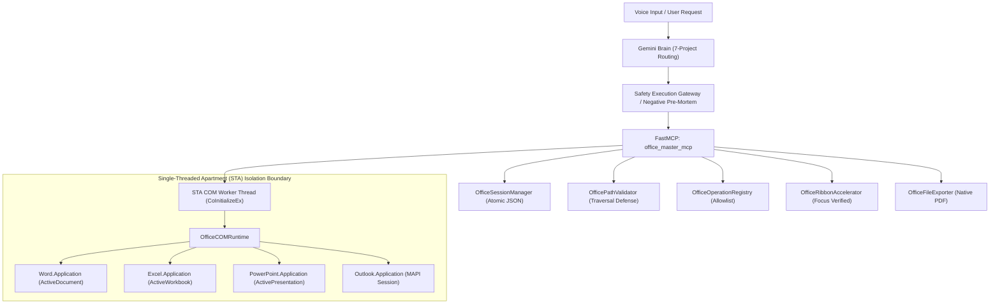

# Zye AI — Day 20 Microsoft Office Live COM Automation Architecture

## 1. Executive Summary
Day 20 establishes a high-performance, Single-Threaded Apartment (STA) Windows COM bridge for Microsoft Word, Excel, PowerPoint, and Outlook within the Zye AI Hybrid Assistant.

By isolating COM invocations to a dedicated background worker thread, Zye prevents Windows COM threading conflicts (`RPC_E_WRONG_THREAD 0x8001010E`), ensures live document synchronization without saving or reopening files, and exposes safe, allowlisted tools to Gemini through FastMCP.

---

## 2. Core Architectural Diagram

---

## 3. Subsystem Breakdown

### 3.1 Dedicated Single-Threaded Apartment (STA) Worker (`STACOMWorker`)
- **Apartment Threading:** Initializes via `pythoncom.CoInitializeEx(pythoncom.COINIT_APARTMENTTHREADED)` upon thread bootstrap.
- **Serialization:** All COM dispatching, property reading, and method calls are queued into a synchronous future channel and executed exclusively within the dedicated thread.
- **Re-Entrancy:** Safe re-entrant calls within the worker thread execute immediately without deadlocking.
- **Lifecycle Management:** Clean termination via `CoUninitialize()` and thread joining.

### 3.2 Office Application Registry (`OfficeAppRegistry`)
- **ProgID Detection:** Directly probes `HKEY_CLASSES_ROOT` for `Word.Application`, `Excel.Application`, `PowerPoint.Application`, and `Outlook.Application`.
- **Version Resolution:** Resolves registry `CurVer` keys to determine installed build versions (e.g. `Word.Application.16`).
- **Live Process Monitoring:** Leverages `psutil` to detect running instances and process IDs (`WINWORD.EXE`, `EXCEL.EXE`, `POWERPNT.EXE`, `OUTLOOK.EXE`).

### 3.3 Live Office Session Manager (`OfficeSessionManager`)
- **Session Isolation:** Allocates stable `sess_<app>_<uuid>` identifiers.
- **State Persistence:** Atomically records session metadata in `data/office_session_metadata.json`.
- **Zero Raw Pointers:** COM dispatch pointers are never serialized or leaked to outer processes; only JSON-serializable telemetry is persisted.

### 3.4 Bounded State Inspector (`OfficeStateInspector`)
- **Active Document Reading:** Inspects live document properties without disturbing user focus or file locks.
- **Word:** Word count, page count, character count, paragraph count, track changes state, and bounded text preview ($\le 1500$ chars).
- **Excel:** Active workbook name, sheets list, active cell, selected range, used range row/col counts, and calculation mode.
- **PowerPoint:** Presentation name, slide count, active slide index, slide dimensions, and slide titles list.
- **Outlook:** Explorer/inspector count, current folder name, unread email count, and profile status.

### 3.5 Allowlisted Operation Registry (`OfficeOperationRegistry`) & Executor (`OfficeOperationExecutor`)
- **Strict Allowlisting:** Strictly zero dynamic `eval()`, `exec()`, or arbitrary VBA macro execution.
- **Typed Schemas:** Every operation defines typed parameters, default values, and risk categories.
- **Supported Operations:**
  - `word.insert_text`, `word.insert_heading`, `word.apply_style`, `word.set_track_changes`, `word.save_document`.
  - `excel.set_cell_value`, `excel.set_cell_formula`, `excel.format_range`, `excel.calculate`, `excel.save_workbook`.
  - `powerpoint.get_slide_details`, `powerpoint.insert_slide`, `powerpoint.set_slide_title`, `powerpoint.save_presentation`.
  - `outlook.create_draft`, `outlook.get_unread_count`.

### 3.6 Native COM PDF Exporter (`OfficeFileExporter`)
- **Native FixedFormat APIs:**
  - Word: `ExportAsFixedFormat(wdExportFormatPDF = 17)`
  - Excel: `ExportAsFixedFormat(xlTypePDF = 0)`
  - PowerPoint: `ExportAsFixedFormat(ppFixedFormatTypePDF = 2)` / `SaveAs(ppSaveAsPDF = 32)`
- **Verification:** Enforces non-zero file size on disk and returns structured export metadata.
- **Overwrite Gate:** Rejects overwriting existing files unless explicitly confirmed (`overwrite=True`).

### 3.7 Foreground-Verified Ribbon Accelerator (`OfficeRibbonAccelerator`)
- **Active Window Focus:** Verifies via `win32gui` and `win32process` that the target application is active before dispatching keystrokes.
- **Auto-Focus Option:** Safely searches and activates matching Office window before keystroke emission.
- **Dangerous Key Filtering:** Blocks hazardous combinations (`alt+f4`, `ctrl+alt+del`, `win`, `delete`).

---

## 4. MCP Server Integration
Exposes 12 high-level FastMCP tools via `office_master_mcp.py`:
1. `office_connect`
2. `office_disconnect`
3. `office_get_session_details`
4. `office_list_sessions`
5. `office_inspect_document`
6. `office_execute_operation`
7. `office_export_pdf`
8. `office_accelerate_ribbon`
9. `office_health_check`
10. `office_check_installation`
11. `office_list_capabilities`
12. `office_list_operations`
