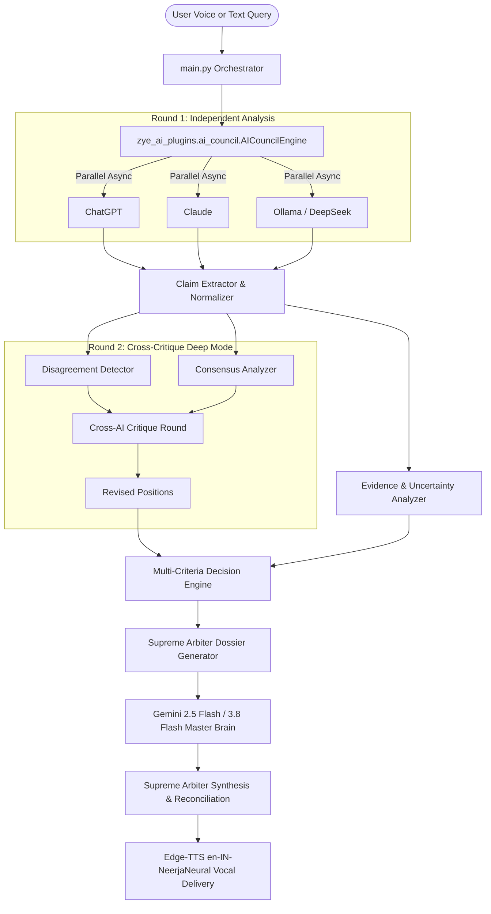

# ZYE AI — DAY 26: ADVANCED MULTI-AI COUNCIL INTELLIGENCE ENGINE

## 1. Overview & System Mission
The Day 26 Advanced Multi-AI Council Intelligence Engine elevates Zye AI's multi-model plugin infrastructure into an institutional-grade advisory deliberation platform. Rather than querying single models in isolation, Zye AI convenes a multi-model council—including OpenAI (ChatGPT), Anthropic (Claude), Local Ollama, Perplexity, DeepSeek, Groq, and OpenRouter—to solve complex technical, architectural, and security challenges.

**Absolute Architectural Law:**
> **Google Gemini Master Brain is the sole, unchallenged Supreme Arbiter.** External AI models act strictly as subordinate advisory witnesses. No external model communicates directly with the user, modifies system state, or overrides Gemini's final judgment. Gemini synthesizes the complete council record and delivers the definitive spoken verdict via Edge-TTS (`en-IN-NeerjaNeural`).

---

## 2. Council Deliberation Modes
The Council operates across three distinct operational modes tailored to latency, depth, and privacy:

```
+-----------------------------------------------------------------------------------+
|                                  COUNCIL MODES                                    |
+--------------------+--------------------------------+-----------------------------+
| Mode               | Participating Models           | Deliberation Depth          |
+--------------------+--------------------------------+-----------------------------+
| QUICK_COUNCIL      | ChatGPT (gpt-4o) +             | Single-Round Independent    |
|                    | Claude (claude-3-5-sonnet)     | Analysis + Fast Gemini Handoff|
+--------------------+--------------------------------+-----------------------------+
| DEEP_COUNCIL       | Configurable Quorum            | Full 4-Round Pipeline with  |
|                    | (3 to 6 models)                | Cross-Critique & Scoring    |
+--------------------+--------------------------------+-----------------------------+
| LOCAL_COUNCIL      | Local Ollama (llama3.2 /       | 100% Offline Air-Gapped     |
|                    | deepseek-r1 / qwen2.5-coder)   | Zero External Cloud Egress  |
+--------------------+--------------------------------+-----------------------------+
```

### 2.1 Quick Council Mode (`run_quick_council`)
- Designed for low-latency queries (<3s target) where rapid multi-angle perspectives are needed.
- Queries ChatGPT and Claude concurrently in parallel.
- Extracts claims, performs automated disagreement scanning, and formats a synthesis dossier for Gemini.

### 2.2 Deep Council Mode (`run_deep_council`)
- Designed for mission-critical architectural decisions, code security audits, and complex system design.
- Executes full multi-round peer cross-examination:
  1. **Round 1:** Independent proposal generation.
  2. **Round 2:** Cross-AI critique (each model evaluates anonymized peer proposals).
  3. **Round 3:** Revised positions & rebuttal defense.
  4. **Round 4:** Multi-criteria weighted scoring and Gemini Supreme Arbiter dossier formatting.

### 2.3 Local Council Mode (`run_local_council`)
- Strict privacy mode: guarantees zero external internet egress.
- Only local Ollama models on `http://127.0.0.1:11434` are queried.
- All cloud APIs (OpenAI, Anthropic, Perplexity, Groq, OpenRouter) are strictly blocked.

---

## 3. Council Architectural Workflow



---

## 4. Primary FastMCP Server (`ai_plugins_mcp.py`)
The server provides 25 registered FastMCP tools, accessible via the MCP orchestrator:
- `run_ai_council`: Comprehensive entry point supporting all modes and weights.
- `run_quick_council`: Fast 2-model comparison.
- `run_deep_council`: Full 4-round deep deliberation.
- `compare_ai_responses`: Direct pairwise response comparison.
- `detect_ai_disagreements`: Contradiction and disagreement extraction.
- `analyze_ai_consensus`: Consensus ratio and minority view analysis.
- `evaluate_candidate_solutions`: Multi-criteria weighted decision scoring.
- `get_ai_council_report`: Retrieve persistent markdown/json council session dossiers.
- `cancel_ai_council`: Asynchronous cancellation of running council deliberation tasks.
