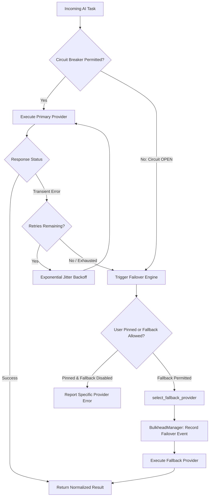

# ZYE AI — DAY 27: AUTOMATIC PROVIDER FAILOVER & RECOVERY

## 1. Failover Principles & Strict Guardrails
When an external AI provider becomes unavailable (due to rate limits, server outages, or network partitions), Zye AI recovers gracefully without user disruption.

**Absolute Failover Laws:**
1. **Never Silently Replace a Pinned Provider:** If the user explicitly asks for Claude (*"Claude mattum use pannu"*), the system will never substitute ChatGPT without informing the user.
2. **Never Violate Local-Only Privacy:** When in `LOCAL_ONLY` mode, fallback must remain strictly within local inference engines (e.g. alternate local Ollama models). Cloud egress is structurally barred.
3. **Never Disguise Failed Council Participants:** In Day 26 Council deliberations, a failed model is recorded as failed. Replacement participants are clearly labeled, and Gemini is provided with the true factual participation record.

---

## 2. Fallback Priority Matrix
When an unpinned provider fails, `select_fallback_provider()` evaluates the fallback chain:

```
+--------------------------------------------------------------------------------+
|                         PROVIDER FALLBACK RESOLUTION                           |
+---------------------+----------------------------------------------------------+
| Failing Provider    | Eligible Fallback Chain (in preference order)            |
+---------------------+----------------------------------------------------------+
| ChatGPT (OpenAI)    | Claude (Anthropic) -> DeepSeek -> Groq -> Local Ollama   |
| Claude (Anthropic)  | ChatGPT (OpenAI) -> DeepSeek -> Groq -> Local Ollama   |
| DeepSeek Cloud      | Groq -> ChatGPT -> Claude -> Local Ollama                |
| Groq Cloud          | DeepSeek -> ChatGPT -> Claude -> Local Ollama            |
| Perplexity          | ChatGPT -> Claude -> Local Ollama                        |
| Local Ollama        | Groq -> DeepSeek -> ChatGPT (only if non-private)        |
+---------------------+----------------------------------------------------------+
```

---

## 3. Failover Execution Workflow



---

## 4. Failover Telemetry & Audit Trail
Every failover event is logged persistently in memory and exposed via `get_failover_history()`:
- `timestamp`: Monotonic epoch time.
- `original_provider`: Name of provider that experienced the failure.
- `fallback_provider`: Name of provider selected as replacement.
- `reason`: Classification of error (e.g. `ReadTimeout`, `HTTP 503`, `Circuit Breaker is OPEN`).
- `task_id`: Traceable request identifier.
- `success`: Whether the fallback invocation succeeded.
