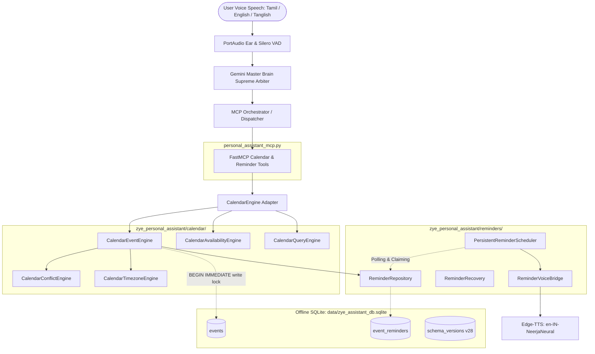

# ZYE AI — Day 28 Smart Calendar Architecture

## 1. System Overview
The Day 28 Smart Calendar subsystem is an enterprise-grade, offline-first personal scheduling engine integrated into Zye Personal Assistant (`zye_personal_assistant`). It delivers real-time meeting conflict detection, automatic overlap blocking, intelligent free-slot recommendations, timezone-aware datetime normalization, persistent multi-state voice reminders, and seamless FastMCP integration for Google Gemini Master Brain.

## 2. Core Architectural Pillars
1. **Gemini Sovereign Law:** Google Gemini Master Brain remains the unchallenged supreme arbiter. All scheduling requests (whether in Tamil, Tanglish, or English) are parsed and understood by Gemini, which dispatches structured FastMCP tool calls.
2. **Offline-First SQLite Storage:** All calendar events, interval indices, and persistent reminder state transitions operate locally in `data/zye_assistant_db.sqlite` with zero cloud egress.
3. **Half-Open Interval Math:** Meeting overlaps are calculated using `existing.start_utc < requested.end_utc AND existing.end_utc > requested.start_utc`. Touching boundary meetings (e.g. 10:00–11:00 and 11:00–12:00) do NOT overlap.
4. **BEGIN IMMEDIATE Atomic Concurrency:** Scheduling operations acquire exclusive write locks to eliminate double-booking race conditions during concurrent voice and UI requests.
5. **Persistent Multi-State Reminders:** 15-minute and 2-minute reminders are tracked in `event_reminders` with a 6-state finite state machine (`PENDING`, `CLAIMED`, `DELIVERED`, `FAILED`, `SUPPRESSED`, `CANCELLED`).
6. **Crash Resilience & Recovery:** Orphaned claims older than 120 seconds are automatically reclaimed on system reboot, while reminders for expired meetings are gracefully suppressed.
