# ZYE AI — Day 28 Persistent Reminder Engine & Voice Bridge

## 1. Lifecycle Finite State Machine
Persistent meeting reminders follow a strictly defined 6-state transition model:

```mermaid
stateDiagram-v2
    [*] --> PENDING: Event Created (>15m / >2m)
    [*] --> SUPPRESSED: Late Event Creation (<15m / <2m)
    
    PENDING --> CLAIMED: Daemon Claims Due Reminder
    PENDING --> CANCELLED: Event Cancelled / Rescheduled
    
    CLAIMED --> DELIVERED: Voice Announcement TTS Finished
    CLAIMED --> FAILED: Audio/TTS/Speech Error
    CLAIMED --> PENDING: Crash Recovery (Claim > 120s old)
    
    FAILED --> PENDING: Retry (< max attempts)
    
    PENDING --> SUPPRESSED: Meeting Already Started on Reboot
```



## 2. Late Creation Suppression Policy
When an event is booked on short notice:
- If scheduled with $\le 14.5$ minutes remaining: 15-minute reminder is generated with status `SUPPRESSED`.
- If scheduled with $\le 1.5$ minutes remaining: 2-minute reminder is generated with status `SUPPRESSED`.

This prevents irritating, outdated voice alerts immediately after an event is scheduled.

---

## 3. Atomic Polling & Claiming
To prevent duplicate voice announcements across worker threads or rapid poll intervals:
```sql
UPDATE event_reminders
SET status = 'CLAIMED', claimed_at_utc = ?, attempt_count = attempt_count + 1
WHERE id = ? AND status = 'PENDING';
```
Only if `rowcount == 1` does the scheduler proceed to trigger Edge-TTS.

---

## 4. Multi-Lingual Voice Phrasing
`reminder_voice_bridge.py` synthesizes personalized voice prompts in 3 languages:

| Scenario | English (`en`) | Tanglish (`tanglish`) | Tamil (`ta`) |
| :--- | :--- | :--- | :--- |
| **15-Minute Alert** | `Meeting Reminder. Your '{title}' starts in 15 minutes.` | `Meeting Reminder. Ungaloda '{title}' meeting innum 15 minutes-la start aaguthu.` | `சந்திப்பு நினைவூட்டல். உங்களுடைய '{title}' சந்திப்பு இன்னும் 15 நிமிடங்களில் தொடங்கும்.` |
| **2-Minute Alert** | `Final Reminder. '{title}' starts in 2 minutes.` | `Final Reminder. '{title}' meeting innum 2 minutes-la start aaguthu.` | `இறுதி நினைவூட்டல். '{title}' சந்திப்பு இன்னும் இரண்டு நிமிடங்களில் தொடங்கும்.` |
| **Catch-up Alert** | `Meeting Alert. '{title}' starts in {N} minutes.` | `Meeting Alert. '{title}' innum {N} minutes-la start aaguthu.` | `சந்திப்பு எச்சரிக்கை. '{title}' இன்னும் {N} நிமிடங்களில் தொடங்கும்.` |
