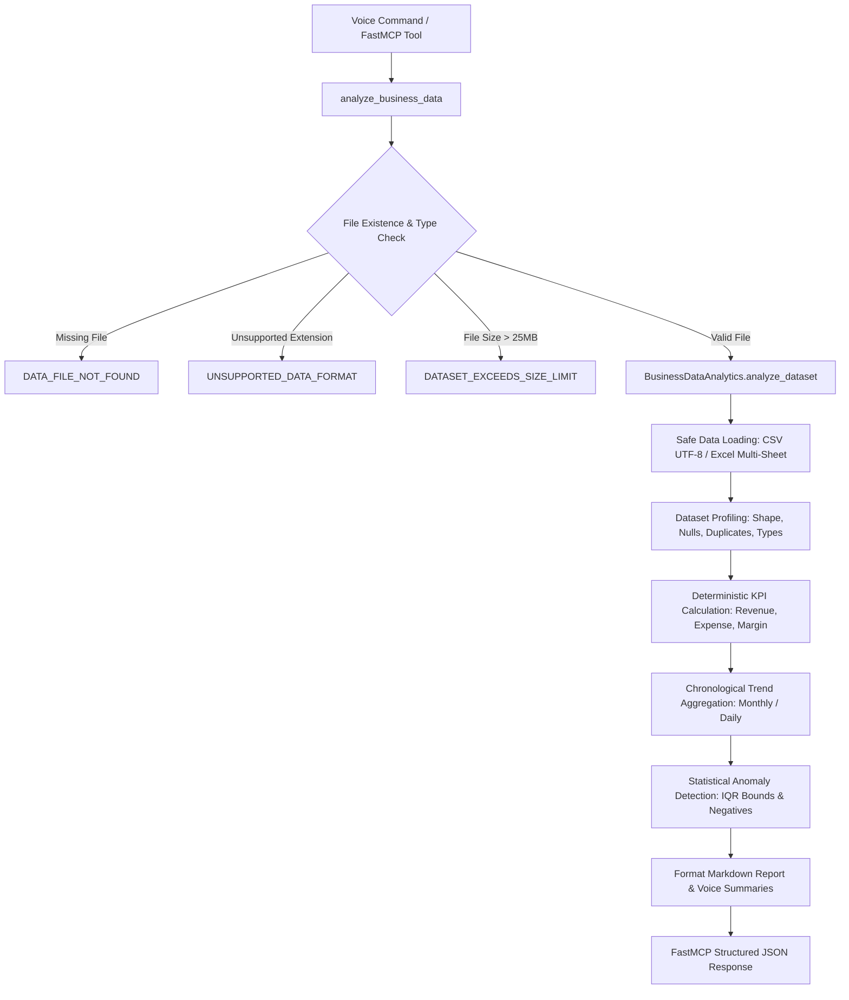

# ZYE AI — DAY 30 BUSINESS DATA ANALYTICS SPECIFICATION

## 1. Executive Summary & Mission
The Day 30 Business Data Analytics Engine (`zye_personal_assistant/business_analytics.py`) provides offline-first, deterministic numerical analysis on tabular business datasets (CSV and Excel formats). Operating without external network dependencies, it guarantees mathematical accuracy for financial KPIs, detects statistical anomalies using Interquartile Range (IQR) bounds, and enforces absolute file integrity through read-only access.

---

## 2. Architecture & Design Principles



---

## 3. Core Analytical Capabilities

### A. Format & Multi-Sheet Support
- **CSV Support**: Parses standard CSV files with `encoding="utf-8"` and `on_bad_lines="skip"`.
- **Excel Support**: Reads `.xlsx` and `.xls` files. Supports explicit `sheet_name` selection, enumerates available sheets, and safely closes file handles using context managers.
- **Safety Limit**: Enforces a 25MB maximum file size ceiling to prevent memory exhaustion.

### B. Dataset Profiling & Data Quality
- Identifies total rows and columns.
- Tallies missing values per column.
- Detects exact duplicate records.
- Classifies columns into numeric, categorical, and date types (with case-insensitive keyword heuristics and sample parsing).

### C. Deterministic Financial KPI Computation
All financial metrics are computed using deterministic Pandas math—never guessed by language models:
- **Total Revenue**: Sum of revenue columns.
- **Total Expenses**: Sum of expense/cost columns.
- **Net Profit**: Calculated as `Total Revenue - Total Expenses`.
- **Profit Margin %**: `(Net Profit / Total Revenue) * 100` guarded against zero or negative denominators (`margin = 0.0%` when `Total Revenue == 0`).

### D. Statistical Anomaly & Outlier Detection
- **Negative Values**: Flags negative numbers in revenue columns.
- **Duplicate Records**: Quantifies exact duplicate rows.
- **IQR Outlier Detection**: For numeric distributions with sample size $N \ge 4$, computes:
  $$IQR = Q_3 - Q_1$$
  $$\text{Lower Bound} = Q_1 - 1.5 \times IQR$$
  $$\text{Upper Bound} = Q_3 + 1.5 \times IQR$$
  Values falling outside $[\text{Lower Bound}, \text{Upper Bound}]$ are flagged with their column name and calculated bounds.

---

## 4. Privacy & Read-Only Guarantee
- **Read-Only Access**: Files are opened strictly for reading. The underlying files on disk are never altered, appended to, or deleted.
- **Zero Raw PII to LLM**: Individual rows and PII are never sent to external LLM endpoints. Only high-level aggregated summary statistics are generated.

---

## 5. FastMCP Tool Interface

```python
@mcp.tool()
def analyze_business_data(
    file_path: str,
    analysis_type: str = "COMPREHENSIVE",
    sheet_name: str | None = None,
) -> dict[str, Any]:
    """Performs deterministic financial KPI computation, dataset profiling, and

    statistical anomaly detection on CSV and Excel datasets.
    """
```
