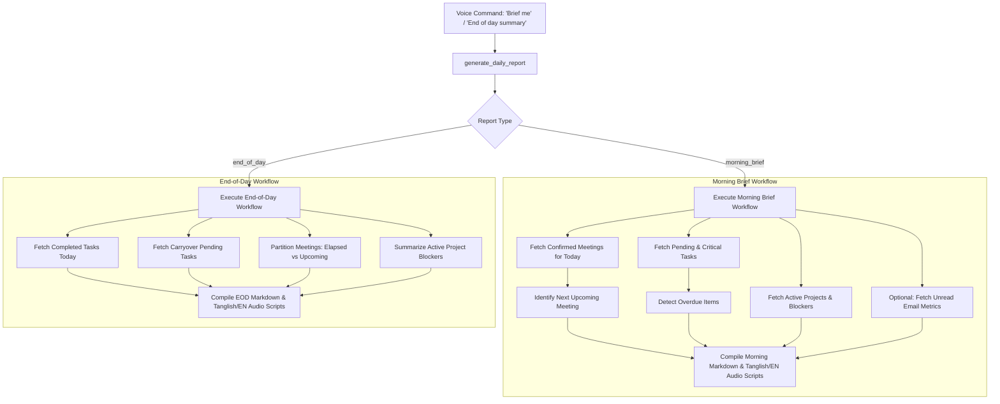

# ZYE AI — DAY 30 DAILY EXECUTIVE BRIEFING ENGINE SPECIFICATION

## 1. Executive Summary & Mission
The Day 30 Daily Executive Briefing Engine (`zye_personal_assistant/daily_report_engine.py`) provides unified operational visibility across the user's workday. By aggregating confirmed meetings from the Day 28 Smart Calendar, critical tasks from the Day 29 Task Scheduler, blockers from the Project Manager, and unread email metrics from the Email Engine, it delivers zero-hallucination Morning Briefs and End-of-Day Executive Summaries.

---

## 2. Architecture & Workflow



---

## 3. Core Features

### A. Morning Briefing (`morning_brief`)
1. **Confirmed Meetings Agenda**: Lists today's confirmed calendar meetings with exact start times, durations, and locations.
2. **Next Meeting Identification**: Automatically computes and highlights the next upcoming meeting (or first opening meeting of the day).
3. **Task Prioritization**: Separates CRITICAL and HIGH priority tasks from routine items.
4. **Overdue Task Detection**: Flags tasks whose `due_iso` date has already passed.
5. **Active Blockers**: Immediately surfaces project blockers so they can be unblocked first thing in the morning.
6. **Zero Hallucination Honesty**: If no meetings are scheduled, explicitly states: *"No confirmed meetings scheduled for today."*

### B. End-of-Day Summary (`end_of_day`)
1. **Accomplishments**: Audits completed tasks with completion timestamps.
2. **Carryover Backlog**: Summarizes remaining pending items to be rescheduled for tomorrow.
3. **Meeting Audit**: Displays elapsed meetings vs any late upcoming meetings.
4. **Blocker Status**: Summarizes unaddressed blockers requiring attention.

---

## 4. FastMCP Tool Interface

```python
@mcp.tool()
def generate_daily_report(
    report_type: str = "morning_brief",
    include_email_summary: bool = False,
) -> dict[str, Any]:
    """Generates structured Morning Briefs or End-of-Day Executive Summaries

    synthesized from calendar, tasks, projects, and email activity.
    """
```
