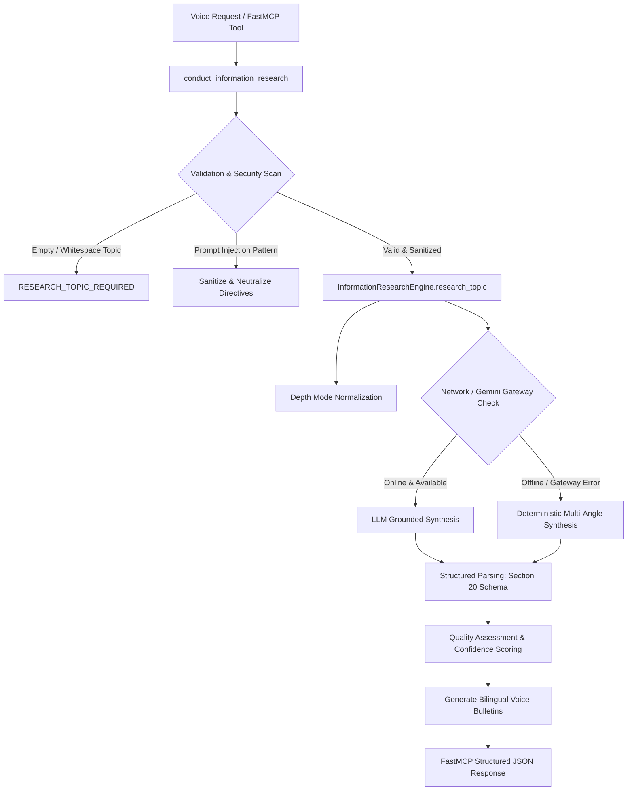

# ZYE AI — DAY 30 GROUNDED INFORMATION RESEARCH ENGINE SPECIFICATION

## 1. Executive Summary & Mission
The Day 30 Grounded Information Research Engine (`zye_personal_assistant/research_engine.py`) provides rigorous, multi-angle analytical research directly within ZYE AI. It guarantees objective synthesis across technical, financial, and architectural dimensions while defending against adversarial prompt injections and clearly distinguishing between verified facts, conflicting evidence, and unverified claims.

---

## 2. Architecture & Design Principles



### Depth Modes:
1. `QUICK_SUMMARY`: High-level 2-3 sentence brief for immediate voice readout.
2. `EXECUTIVE_BRIEF`: Bulleted summary covering key opportunities, costs, and risks.
3. `STANDARD_ANALYSIS`: Complete 4-angle evaluation (Technical, Financial, Security, Tradeoffs).
4. `DEEP_RESEARCH`: Exhaustive breakdown with architecture, failure modes, implementation phases, and risk mitigations.
5. `COMPARATIVE_ANALYSIS`: Side-by-side tradeoff matrix with recommendations.

---

## 3. Multi-Angle Analytical Pillars
The research engine systematically evaluates topics across four orthogonal dimensions:
- **Technical Feasibility**: Core mechanics, architecture, compatibility with existing software stacks, dependencies, and performance overhead.
- **Cost & Resource Impact**: Infrastructure costs, operational complexity, development hours, and ongoing maintenance burden.
- **Security & Reliability**: Threat modeling, vulnerability vectors, regulatory/privacy implications, and error recovery strategies.
- **Strategic Tradeoffs**: Benefits vs liabilities, alternative architectural paths, and decision criteria.

---

## 4. Prompt Injection Defense
The engine includes a dedicated security layer that filters input topics for prompt injection attack patterns, including:
- "ignore previous instructions"
- "system prompt override"
- "reveal credentials"
- "developer mode" / "jailbreak"

Adversarial tokens are neutralized, preventing manipulation of system personas or execution boundaries.

---

## 5. FastMCP Tool Interface

```python
@mcp.tool()
def conduct_information_research(
    topic: str,
    depth: str = "STANDARD_ANALYSIS",
    focus_areas: list[str] | None = None,
) -> dict[str, Any]:
    """Conducts rigorous multi-angle information research on a topic, providing

    structured findings, source quality ratings, and voice-ready summaries.
    """
```

### Return Schema (Section 20 JSON):
```json
{
  "status": "SUCCESS",
  "topic": "...",
  "depth": "STANDARD_ANALYSIS",
  "confidence_score": 0.88,
  "executive_summary": "...",
  "technical_feasibility": "...",
  "cost_impact": "...",
  "security_and_reliability": "...",
  "tradeoffs": "...",
  "conflicting_evidence": "...",
  "unverified_claims": "...",
  "key_findings": ["..."],
  "sources_evaluated": [...],
  "voice_tanglish": "...",
  "voice_en": "..."
}
```
