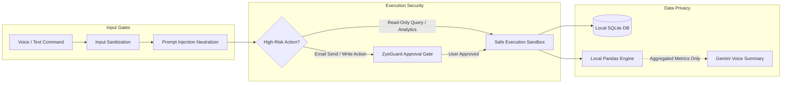

# ZYE AI — DAY 30 SECURITY & RELIABILITY SPECIFICATION

## 1. Security Architecture & Threat Model
The Personal Assistant ecosystem handles sensitive enterprise data: email communication, proprietary business datasets, calendars, and organizational task structures. Day 30 enforces defense-in-depth across every subsystem.

---

## 2. Core Security Controls

### A. Path Traversal & File Access Protection
- All document paths are validated using `pathlib.Path.resolve()`.
- Access is restricted to explicitly authorized project and data directories.
- System directories (`C:\Windows`, system registry, app data boundaries) are strictly prohibited.
- Business analytics strictly requires read-only access (`r` mode / read pandas engines). No modification of source CSV or Excel files occurs.

### B. Prompt Injection Neutralization
The Information Research engine inspects input text for adversarial jailbreaks, command overriding tokens, and directive manipulation. Injected instructions are stripped before analysis, guaranteeing that AI personas and tool invocation boundaries cannot be bypassed.

### C. ZyeGuard Approval Gates
Operations that produce external side effects—such as dispatching outgoing emails via SMTP—cannot execute autonomously without explicit user confirmation. Drafts are safely stored in the `email_drafts` table until user approval is logged.

### D. Zero Raw PII Exfiltration
Business analytics operates locally on CPU via Python and Pandas. Individual rows, client identities, and transaction logs never leave the local environment. Only aggregated statistical summaries are formatted for optional Gemini Live voice synthesis.

### E. Concurrency & Database Integrity
The SQLite database (`data/zye_assistant_db.sqlite`) uses WAL (Write-Ahead Logging) mode and connection timeouts to prevent locks during concurrent background reminder sweeps and interactive voice queries.
