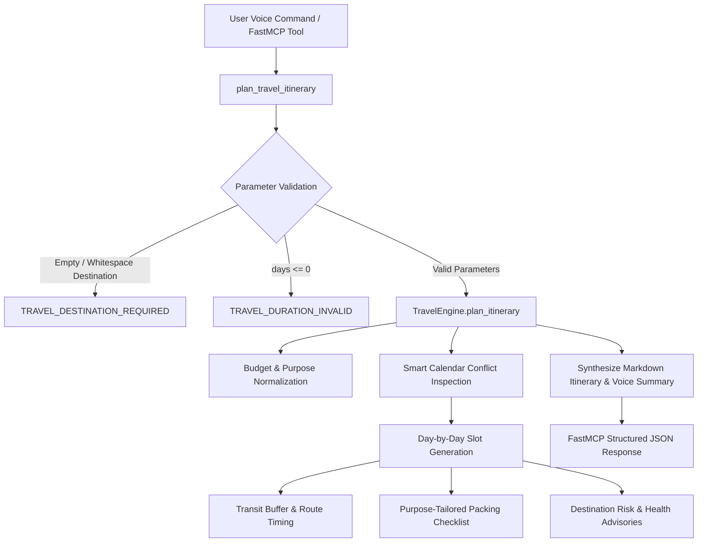

# ZYE AI — DAY 30 TRAVEL PLANNING ENGINE SPECIFICATION

## 1. Executive Summary & Mission
The Day 30 Travel Planning Engine (`zye_personal_assistant/travel_engine.py`) upgrades ZYE AI with intelligent, deterministic, and calendar-aware itinerary generation. Operating under the Personal Assistant MCP (`personal_assistant_mcp.py`), it transforms natural voice commands into structured, realistic multi-day itineraries with packing checklists, budget tier allocations, transit buffers, and automated conflict detection against existing calendar commitments.

---

## 2. Architecture & Design Principles



### Core Invariants:
1. **Strict Input Validation**: Rejects empty, whitespace-only, or non-string destinations; validates `days > 0`.
2. **Budget Tiers**: Supports `BUDGET` (cost-effective transit & hostels), `MID_RANGE` (standard hotels & balanced dining), and `LUXURY` (premium chauffeur & fine dining).
3. **Purpose Tailoring**: Tailors schedules and packing essentials based on `BUSINESS` (formal wear, presentation tech, corporate transit), `LEISURE` (comfort wear, sightseeing), or `ADVENTURE` (rugged gear, first-aid, trail maps).
4. **Calendar Integration**: Inspects the Day 28 SQLite calendar database when `start_date_iso` is supplied. Conflicts are flagged explicitly in the itinerary and response metadata without silent overrides.
5. **Full Duplex Voice Summaries**: Generates bilingual voice summaries (Tanglish and English) designed for low-latency Gemini Live audio output.

---

## 3. FastMCP Tool Interface

```python
@mcp.tool()
def plan_travel_itinerary(
    destination: str,
    days: int,
    budget_tier: str = "MID_RANGE",
    purpose: str = "LEISURE",
    start_date_iso: str | None = None,
    check_calendar_conflicts: bool = True,
) -> dict[str, Any]:
    """Plans a comprehensive day-by-day travel itinerary with packing checklist,

    budget recommendations, and optional calendar conflict detection.
    """
```

### Parameter Reference:
- `destination` (`str`, required): Target city, country, or region (e.g. "Tokyo", "London", "Bengaluru").
- `days` (`int`, required): Total trip duration in days (must be `>= 1`).
- `budget_tier` (`str`, optional): `BUDGET` | `MID_RANGE` | `LUXURY` (defaults to `MID_RANGE`).
- `purpose` (`str`, optional): `BUSINESS` | `LEISURE` | `ADVENTURE` (defaults to `LEISURE`).
- `start_date_iso` (`str`, optional): ISO 8601 trip start date (e.g. "2026-12-01").
- `check_calendar_conflicts` (`bool`, optional): When `True` and `start_date_iso` is provided, queries Day 28 Smart Calendar for overlapping events.

---

## 4. Packing Checklist Generation
Checklists are partitioned into four mandatory categories:
- **Documents & Essentials**: Passport, visa, travel insurance, photo ID, credit cards, boarding passes.
- **Electronics**: Smartphone, universal travel adapter, multi-port charger, power bank, noise-canceling headphones.
- **Clothing & Apparel**: Tailored specifically to the trip purpose and expected duration.
- **Toiletries & Health**: Prescription medications, travel first-aid kit, grooming essentials.

---

## 5. Security & Isolation
- **Read-Only Database Access**: Calendar verification performs non-locking `SELECT` queries without modifying any existing calendar events.
- **Safe String Handling**: Destination and parameters undergo sanitization to prevent prompt injection or script execution when rendered in downstream UIs.
