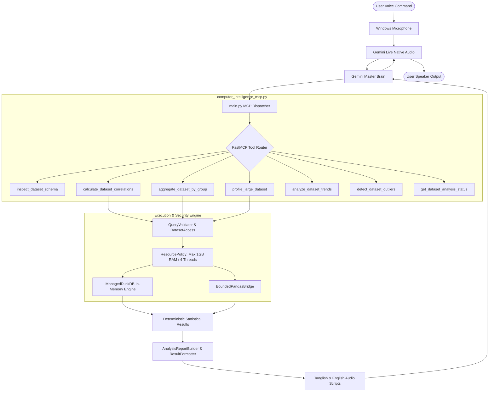

# ZYE AI — DAY 31 COMPUTER INTELLIGENCE ARCHITECTURE SPECIFICATION

## 1. Executive Summary & Mission
Day 31 initiates **Phase 3: Big Data Intelligence, Cybersecurity & Engineering R&D Lab**. The Computer Intelligence subsystem introduces columnar big-data processing, DuckDB SQL execution, memory-efficient CSV/Excel streaming, and advanced statistical correlation analysis into ZYE AI. Operating via the FastMCP protocol through `computer_intelligence_mcp.py`, it empowers Gemini Live to comprehend, query, and explain massive tabular datasets without freezing the Windows desktop or sending raw row data to external models.

---

## 2. High-Level System Architecture

---

## 3. Modular Engine Breakdown

The `zye_computer_intelligence/` package is structured into four specialized layers:

1. **`data_engine/`**:
   - `duckdb_engine.py`: Manages in-memory DuckDB connections with thread boundaries and memory ceilings (`SET memory_limit='1024MB'`, `SET threads=4`).
   - `schema_inspector.py`: Performs non-materializing schema discovery using DuckDB `DESCRIBE` and header sampling.
   - `query_planner.py`: Assembles structured, parameter-bound DuckDB SQL queries for group aggregation, time trends, missing values, and percentiles.
   - `query_validator.py`: Enforces analytical allowlists, identifier quoting, and detects SQL injection attempts.
   - `dataset_loader.py`: Routes between DuckDB (CSV, TSV, Parquet) and Pandas (Excel).
   - `pandas_bridge.py`: Safely converts DuckDB relations to bounded DataFrames within strict row ceilings.

2. **`statistics/`**:
   - `correlation_engine.py`: Computes Pearson linear and Spearman monotonic rank correlations with noncausality guardrails.
   - `summary_statistics.py`: Calculates numeric percentiles ($Q_1$, Median, $Q_3$, IQR), standard deviations, missing-value types, and duplicate rows.
   - `segment_analytics.py`: Executes SQL-based group-by aggregations and category percentages.
   - `trend_engine.py`: Performs time-series rollups and directional trajectory evaluation.
   - `anomaly_engine.py`: Identifies IQR bound violations and negative revenue anomalies.

3. **`reporting/`**:
   - `analysis_report.py`: Assembles Section 38/46 JSON reports with execution telemetry.
   - `result_formatter.py`: Generates Markdown summary dashboards and low-latency Gemini Live voice scripts.

4. **`security/`**:
   - `dataset_access.py`: Resolves canonical paths, enforces file size ceilings (2 GB), and blocks access to Windows system directories.
   - `resource_policy.py`: Governs RAM/CPU budgets and tracks asynchronous analytical jobs.
