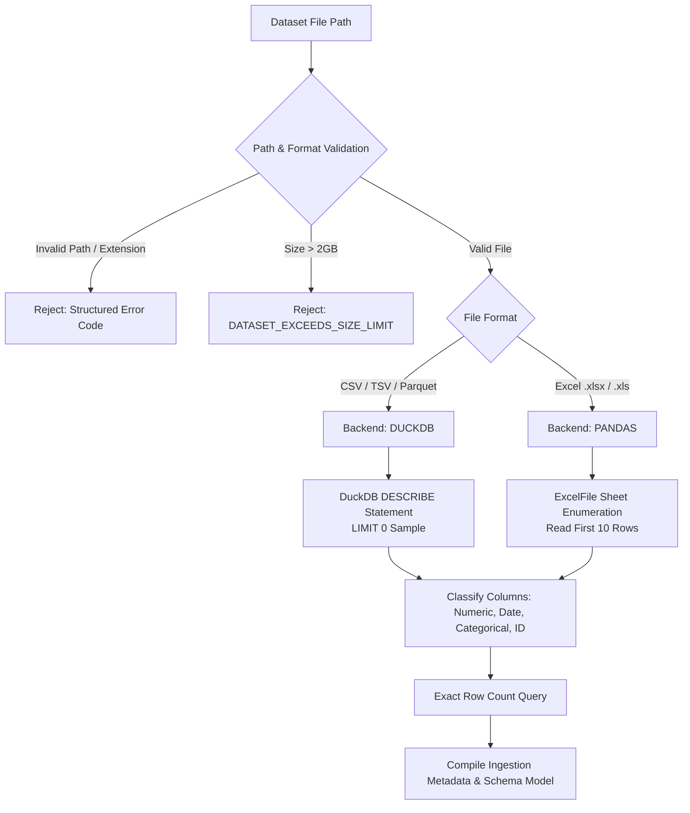

# ZYE AI — DAY 31 CSV & EXCEL INGESTION SPECIFICATION

## 1. Overview & Format Coverage
The Day 31 ingestion pipeline handles diverse tabular data formats commonly found in enterprise and research workflows:
- **CSV (`.csv`)**: Comma-delimited files, streaming via DuckDB.
- **TSV (`.tsv`)**: Tab-delimited files, streaming via DuckDB.
- **Compressed CSV (`.csv.gz`)**: Gzip-compressed CSV streams.
- **Excel OpenXML (`.xlsx`)**: Modern multi-sheet workbooks via pandas/openpyxl.
- **Excel Legacy (`.xls`)**: Classic binary workbooks.
- **Parquet (`.parquet`)**: High-performance columnar data files.

---

## 2. Ingestion & Schema Inspection Workflow

---

## 3. Read-Only Disk Preservation Guarantee

ZYE AI strictly enforces read-only access on all analyzed datasets:
- **Zero In-Place Mutations**: Files are opened with read-only flags (`mode="r"` or DuckDB read functions).
- **No Temporary Overwrites**: Intermediate analysis results are stored exclusively in in-memory DuckDB tables or designated temporary directories.
- **Audit Verification**: Verified in `test_03_read_only_guarantee_preserves_disk_files` by asserting SHA hashes and byte sizes before and after analytical queries.
