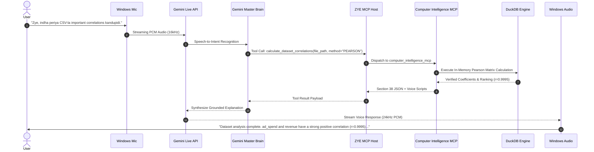

# ZYE AI — DAY 31 GEMINI LIVE VOICE INTEGRATION SPECIFICATION

## 1. Natural Voice Workflow

---

## 2. Natural Voice Commands Supported

### Tamil & Tanglish:
- *"Zye, indha periya CSV file analyze pannu."*
- *"Indha dataset-la evvalavu rows irukku?"*
- *"Column names and data types sollu."*
- *"Missing values irukka check pannu."*
- *"Duplicate records evvalavu irukku?"*
- *"Sales data-la strongest correlations kandupidi."*
- *"Category-wise sales summary kudu."*
- *"Running analysis stop pannu."*

### English:
- *"Analyze this large CSV dataset."*
- *"What is the schema and row count of this file?"*
- *"Find the strongest correlations between numeric columns."*
- *"Detect any statistical outliers in revenue."*
- *"Calculate group totals by category."*
