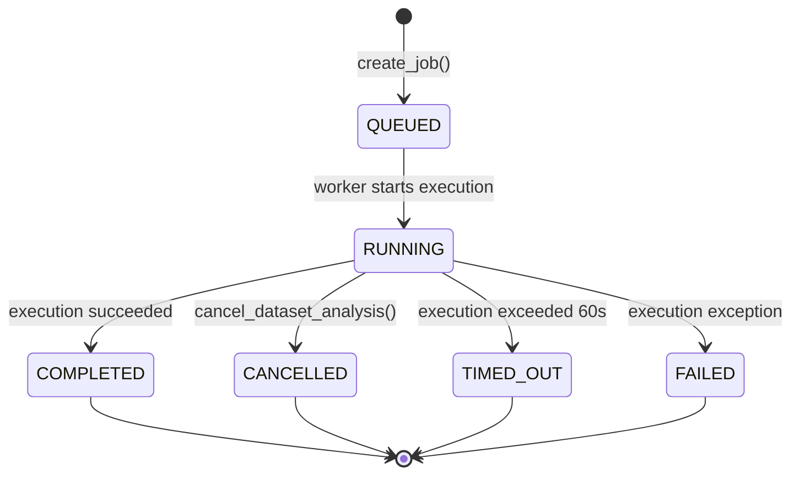

# ZYE AI — DAY 31 RESOURCE GOVERNANCE SPECIFICATION

## 1. Resource Policy & Constraints
Operating on a personal Windows laptop requires deterministic limits on resource usage to prevent background analytics from interrupting user audio, video conferencing, or foreground desktop apps.

### Core Ceilings:
- **Maximum Working Memory**: `1,024 MB` (1 GB) for DuckDB query buffers.
- **CPU Worker Threads**: Bound to `4` parallel threads.
- **Disk Spill Safety**: Spills to `<tempdir>/zye_duckdb_temp` capped at `2,048 MB`.
- **Query Timeout**: Hard cancellation timeout at `60.0` seconds.

---

## 2. Analysis Job Lifecycle & Cancellation

Long-running analytics jobs are tracked via the thread-safe `JobManager`:

### Cancellation Protocol:
1. When `cancel_dataset_analysis(job_id)` is called via FastMCP, the job's `cancellation_requested` flag is flipped to `True`.
2. Ongoing DuckDB connections associated with the job identifier are interrupted.
3. Temporary spill files are reclaimed immediately.
