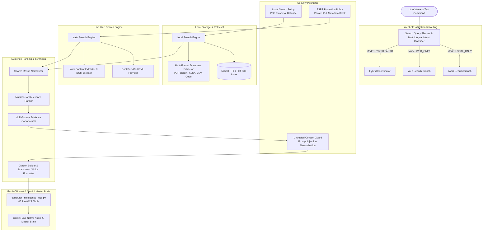

# Day 33 Architecture Specification: Hybrid Local + Web Search Intelligence Engine

## 1. Executive Summary

Day 33 of the ZYE AI hybrid personal assistant engineering roadmap implements the **Hybrid Local + Web Search Intelligence Engine**. This system bridges offline-first desktop knowledge with live internet search, enabling ZYE to autonomously plan search queries, retrieve facts from local documents and codebases, query authorized web providers, corroborate evidence across multiple sources, and present traceable source citations in both rich Markdown and low-latency Gemini Live bilingual speech.

The entire architecture strictly complies with ZYE's core architectural tenets:
- **Offline-First & Local-First:** Local document queries execute directly against local files and offline SQLite FTS5 indices without external network dependencies.
- **Zero-Credential Web Retrieval:** Live web search operates using zero-credential HTML search scraping and standards-compliant HTTP retrieval without requiring proprietary search API keys.
- **Enterprise-Grade Defense:** Strict boundary enforcement prevents path traversal, blocks SSRF attempts (internal IP ranges, cloud metadata services, non-HTTP protocols), and neutralizes adversarial prompt injection patterns in retrieved content.
- **Incremental Tool Expansion:** Preserves all existing 28 FastMCP tools from Day 31 (Big Data) and Day 32 (Mathematics), seamlessly registering 17 new Search Intelligence tools to bring the total to 45 tools on `computer_intelligence_mcp`.

---

## 2. System Architecture Diagram

---

## 3. Subsystem Breakdown

### 3.1 Security Perimeter
1. **LocalSearchPolicy (`zye_computer_intelligence.security.local_search_policy`):**
   - Restricts all local disk lookups to explicitly authorized workspace root directories.
   - Forbids path traversal attempts (`..`, alternate drives, symlink loops).
   - Excludes sensitive files (`.env`, `.pem`, `.key`, `id_rsa`, `cookies.sqlite`).
   - Prunes developer directories (`.git`, `node_modules`, `.venv`, `__pycache__`).
2. **SSRFProtectionPolicy (`zye_computer_intelligence.security.web_url_security`):**
   - Enforces HTTP/HTTPS protocol restrictions.
   - Blocks loopback (`127.0.0.1`, `[::1]`, `localhost`), private RFC 1918 subnets (`10.0.0.0/8`, `172.16.0.0/12`, `192.168.0.0/16`), and internal domain suffixes (`.local`, `.internal`, `.lan`).
   - Blocks cloud metadata endpoints (`169.254.169.254`, `100.100.100.200`).
3. **UntrustedContentGuard (`zye_computer_intelligence.security.untrusted_content_guard`):**
   - Scans incoming web text for adversarial injection prompts (`"ignore previous instructions"`, `"system prompt reveal"`).
   - Neutralizes formatting tags and wraps retrieved content inside unambiguous `<EVIDENCE_DATA>` blocks to prevent context hijacking.

### 3.2 Information Retrieval Core
1. **Local Document Extractor (`local_document_extractor.py`):**
   - Modular extractors for PDF (`pypdf`), Word (`python-docx`), Excel/CSV (`openpyxl`, `csv`), Code (`.py`, `.ts`, `.cpp`), and plain text.
2. **SQLite FTS5 Index Manager (`local_index_manager.py`):**
   - Maintains an incremental full-text search index (`local_search_fts.db`) using the Porter Unicode61 tokenizer.
   - Uses file size, modification timestamps, and content hashes to index only newly added or modified documents.
3. **Web Search & Content Extractor (`web_search_engine.py`, `web_content_extractor.py`):**
   - DuckDuckGo HTML scraping provider for credential-free search queries.
   - Robust HTML DOM sanitization via `lxml.html` stripping `<script>`, `<style>`, `<nav>`, and tracking scripts.

### 3.3 Synthesis & Output Engine
1. **Result Normalizer & Ranker (`search_result_normalizer.py`, `search_result_ranker.py`):**
   - Standardizes disparate local and web results into a unified schema.
   - Multi-factor relevance scoring combining exact phrase bonus, BM25 keyword matching, authority tiers (`OFFICIAL`, `ACADEMIC`, `SECONDARY`), and content freshness.
2. **Evidence Validation Engine (`evidence_validation_engine.py`):**
   - Assesses claim corroboration across multiple independent sources.
   - Detects version conflicts (e.g. installed local library vs latest web release).
3. **Citation Builder (`citation_builder.py`):**
   - Emits structured citations for UI presentation (`[^1]: Local file: 'main.py'`).
   - Builds concise bilingual voice summaries in Tanglish and English for Gemini Live streaming.
