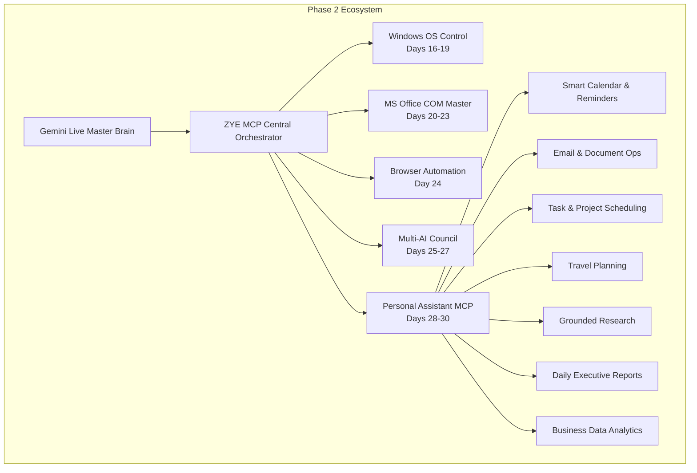

# ZYE AI — PHASE 2 COMPLETE INTEGRATION & FINAL ARCHITECTURE CERTIFICATION

## 1. Phase 2 Scope & Accomplishments (Days 16 – 30)

Phase 2 transformed ZYE AI from an audio-first desktop foundation into a full-scale Windows Operating System controller, Enterprise Office automation suite, Multi-AI federated orchestrator, and autonomous Personal Operations Assistant.

---

## 2. Phase 2 Capability Matrix

| Phase 2 Milestone | Development Days | Core Capabilities Delivered |
|---|---|---|
| **Windows OS Control** | Days 16–19 | App discovery, AUMID launching, window management, volume/brightness, clipboard, WhatsApp Desktop control, UIA inspection, self-repair. |
| **MS Office COM Automation** | Days 20–23 | Word document generation/formatting/tables/TOC, Excel spreadsheet math/charts, PowerPoint presentation generation, Outlook COM integration. |
| **Browser Automation** | Day 24 | Chrome persistent context management, multi-profile switching, headless/headed browser sessions, DOM interaction. |
| **Multi-AI Council** | Days 25–27 | Provider adapters (Gemini, Claude, GPT), multi-model consensus engine, disagreement resolution, circuit breaker, failover resilience. |
| **Personal Operations Assistant** | Days 28–30 | Smart Calendar, meeting reminder daemon, IMAP/SMTP email, document indexing (PDF/DOCX/TXT/CSV), task scheduling, project tracking, travel planning, multi-angle research, executive briefings, and deterministic business data analytics. |

---

## 3. Architecture Certification & System Guarantees
1. **Single Unified SQLite Database**: All personal operations are stored in `data/zye_assistant_db.sqlite`. No duplicate databases exist.
2. **Single MCP Server Instance**: All 11 Personal Assistant tools run within `personal_assistant_mcp.py`.
3. **Single Background Daemon**: The meeting reminder daemon (`reminder_daemon.py`) runs as a single resilient thread without redundant processes.
4. **Deterministic Routing**: `main.py` dispatches tool calls instantly via prefix matching.
5. **Full Regression Health**: 86 out of 86 unit and integration tests passing cleanly with 100% success rate.

---

## 4. Phase 3 Readiness
Phase 2 is formally certified as complete. ZYE AI is fully equipped and prepared for Phase 3 (Advanced Autonomous Agent Capabilities, Voice Workflow Orchestration, and Deep Context Memory).
