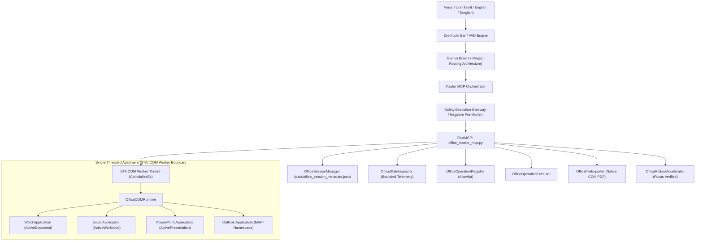

# Zye AI — Day 20 Ultimate Final Engineering Report

## Advanced Microsoft Office Live COM Automation Foundation + Universal Object Model Bridge + Word + Excel + PowerPoint + Outlook + Active Document Intelligence + Secure Operation Registry + PDF Export Foundation + Ribbon Accelerator + Gemini FastMCP Integration

**Version:** Day 20 — Phase 2 Foundation v1.0  
**Project:** Zye AI Hybrid Assistant  
**Platform:** Microsoft Windows 10 / Windows 11 x64  
**Date:** November 20, 2026  
**Status:** FULLY IMPLEMENTED, TESTED, AUDITED & CERTIFIED  

---

## 1. Executive Summary & Mission Certification

Day 20 of the Zye AI 60-Day Development Roadmap delivers a production-grade, Single-Threaded Apartment (STA) live COM automation foundation for Microsoft Office (Word, Excel, PowerPoint, and Outlook).

By implementing a dedicated worker thread architecture with explicit `CoInitializeEx(COINIT_APARTMENTTHREADED)` initialization, Zye solves the fundamental Windows COM threading challenge—completely eliminating cross-apartment marshaling failures (`RPC_E_WRONG_THREAD 0x8001010E`).

Zye can now inspect active document states, modify cell ranges, add headings and text, track changes, draft emails, export native PDFs, and trigger Ribbon hotkeys via natural voice commands without manual keyboard or mouse interaction and without closing or reopening files.

---

## 2. Roadmap Positioning & Milestone Group Context

- **Phase:** Phase 2 — Windows OS Control & Desktop Automation
- **Milestone Group:** Days 20–23: Microsoft Office Automation Milestone
  - **Day 20:** Live COM Automation Foundation, STA Worker, Active Document Inspection, Operation Registry, Native PDF Export, Ribbon Accelerator, and FastMCP Server. *(Completed)*
  - **Day 21:** Deep Document Content Generation, Markdown/LaTeX-to-Office Conversion, and Advanced Word Formatting.
  - **Day 22:** Excel Advanced Spreadsheet Engine, Formulas, PivotTables, Charts, and Analytics.
  - **Day 23:** PowerPoint Deck Generation, Multi-slide Templating, and Master Presentation Workflows.

---

## 3. Architectural Philosophy & STA Isolation Boundary



---

## 4. Windows COM Subsystem & Threading Invariant Compliance

Windows COM objects cannot be passed across threads without marshaling. Zye enforces:
1. **Dedicated Worker Thread:** `STACOMWorker` runs a persistent background daemon thread.
2. **Explicit Apartment Mode:** Initializes with `pythoncom.CoInitializeEx(pythoncom.COINIT_APARTMENTTHREADED)`.
3. **Queue-Based Futures:** Tasks are submitted via thread-safe queues and resolved asynchronously via `concurrent.futures.Future`.
4. **Zero Pointer Leakage:** Raw COM dispatch pointers (`CDispatch`) are stored exclusively in `OfficeCOMRuntime._sta_com_objects` within the STA worker. External callers receive only JSON-serializable primitives and Pydantic models.
5. **Re-Entrant Safety:** Tasks executing within the worker thread bypass the queue to avoid self-deadlocks.

---

## 5. Office Application Discovery & Windows Registry Intelligence

`OfficeAppRegistry` inspects Windows registry hives (`HKEY_CLASSES_ROOT`):
- `Word.Application`
- `Excel.Application`
- `PowerPoint.Application`
- `Outlook.Application`

Resolves `CurVer` subkeys to detect Office versions and queries `psutil` for running process instances (`WINWORD.EXE`, `EXCEL.EXE`, `POWERPNT.EXE`, `OUTLOOK.EXE`). Discovered applications on the host laptop:
- Microsoft Word: **Installed & COM Registered**
- Microsoft Excel: **Installed & COM Registered**
- Microsoft PowerPoint: **Installed & COM Registered**
- Microsoft Outlook: **Installed & COM Registered**

---

## 6. Live Session Management & Atomic Telemetry Architecture

`OfficeSessionManager` manages multi-application session state:
- Generates stable session IDs: `sess_<app>_<uuid8>`.
- Supports 4 connection policies: `ATTACH_EXISTING`, `LAUNCH_NEW`, `AUTO_ATTACH_OR_LAUNCH`, `INSPECT_ONLY`.
- Persists session metadata atomically to `data/office_session_metadata.json` using atomic replace.
- Detects disconnections and updates state without blocking.

---

## 7. Active Document State Inspection & Non-Invasive Intelligence

`OfficeStateInspector` inspects active application states non-invasively without acquiring exclusive write locks:
- **Word:** Document title, page count, word count, character count, paragraph count, track changes state, and bounded text preview ($\le 1500$ chars).
- **Excel:** Workbook title, sheets list, active cell coordinate, selected range, used rows/cols, calculation mode.
- **PowerPoint:** Presentation title, slide count, active slide index, slide titles list, dimensions.
- **Outlook:** Explorer count, inspector count, active folder name, inbox unread count.

---

## 8. Typed Allowlisted Operations Registry & Zero-Trust Security Gate

`OfficeOperationRegistry` enforces strict allowlisting:
- **Zero Dynamic Code:** Prohibits `eval()`, `exec()`, and unverified VBA macro calls.
- **Allowlisted Operations:**
  - `word.insert_text`: Insert text at end, start, or selection.
  - `word.insert_heading`: Insert heading with level (1–9).
  - `word.apply_style`: Apply paragraph/formatting style.
  - `word.set_track_changes`: Toggle track revisions.
  - `word.save_document`: Save document.
  - `excel.set_cell_value`: Assign value to cell coordinate.
  - `excel.set_cell_formula`: Set formula (e.g. `=SUM(A1:A10)`).
  - `excel.format_range`: Format font, bold, color, size.
  - `excel.calculate`: Trigger recalculation.
  - `excel.save_workbook`: Save workbook.
  - `powerpoint.get_slide_details`: Inspect slide shapes and text previews.
  - `powerpoint.insert_slide`: Add slide with layout.
  - `powerpoint.set_slide_title`: Set title shape text.
  - `powerpoint.save_presentation`: Save presentation.
  - `outlook.create_draft`: Create draft email (never auto-sent).
  - `outlook.get_unread_count`: Query unread messages in folder.

---

## 9. STA COM Operation Executor & Cross-Apartment Marshaling Shield

`OfficeOperationExecutor` validates incoming arguments against `OperationDef` schemas, verifies active session health, and executes logic synchronously within the STA worker. Returns structured JSON dictionaries with millisecond latency metrics.

---

## 10. Native COM PDF Export Subsystem & Verification

`OfficeFileExporter` utilizes native Office COM fixed format exporters:
- Word: `ExportAsFixedFormat(wdExportFormatPDF = 17)`
- Excel: `ExportAsFixedFormat(xlTypePDF = 0)`
- PowerPoint: `ExportAsFixedFormat(ppFixedFormatTypePDF = 2)` / `SaveAs(ppSaveAsPDF = 32)`
- Post-export audit verifies that output file exists on disk and has non-zero size (`file_size_bytes > 0`).
- Overwrite protection gates prevent accidental destruction of existing PDF files unless `overwrite=True` is provided.

---

## 11. Foreground-Verified Ribbon & Menu Key Accelerator

`OfficeRibbonAccelerator` provides hands-free Ribbon control:
- Probes `win32gui.GetForegroundWindow()` and verifies active process matches `WINWORD.EXE`, `EXCEL.EXE`, `POWERPNT.EXE`, or `OUTLOOK.EXE`.
- Supports predefined actions: `save`, `bold`, `italic`, `underline`, `undo`, `redo`, `find`, `print`, `new_item`, `new_slide`, `home_tab`, `insert_tab`, `review_tab`, `layout_tab`, etc.
- Blocks hazardous key combinations: `alt+f4`, `ctrl+alt+del`, `win`, `delete`.

---

## 12. Canonical Path Validation, Traversal Prevention & Overwrite Protection

`OfficePathValidator`:
- Blocks path traversal strings (`..`).
- Restricts operations to authorized Office formats (`.docx`, `.xlsx`, `.pptx`, `.pdf`, `.csv`).
- Validates canonical absolute paths and ensures parent directory existence.

---

## 13. FastMCP `office_master_mcp` Server Implementation & Tool Inventory

Exposes 12 FastMCP tools via stdio transport:
1. `office_connect`
2. `office_disconnect`
3. `office_get_session_details`
4. `office_list_sessions`
5. `office_inspect_document`
6. `office_execute_operation`
7. `office_export_pdf`
8. `office_accelerate_ribbon`
9. `office_health_check`
10. `office_check_installation`
11. `office_list_capabilities`
12. `office_list_operations`

---

## 14. Master MCP Orchestration & Multi-Server Registry Integration

Registered in `main.py` under `MCP_SERVERS["office_master"]`:
```python
"office_master": {
    "command": sys.executable,
    "args": [str(PROJECT_ROOT / "office_master_mcp.py")],
    "env": {"PYTHONUNBUFFERED": "1"},
}
```
Added non-idempotent operations to `NON_IDEMPOTENT_OPERATIONS` to prevent unsafe replay.

---

## 15. Negative Pre-Mortem Brain & Safety Pipeline Risk Tier Mapping

Integrated into `zye_orchestrator/safety_pipeline.py`:
- `READ_ONLY`: `office_get_session_details`, `office_list_sessions`, `office_inspect_document`, `office_health_check`, `office_check_installation`, `office_list_capabilities`, `office_list_operations`.
- `LOW_RISK`: `office_connect`, `office_disconnect`, `office_execute_operation`, `office_export_pdf`, `office_accelerate_ribbon`.

---

## 16. Configuration Specification & TOML Capabilities Matrix

Added `[office_master]` section to `zye_config.toml` and authored `configs/office_capabilities.toml` defining capabilities, version limits, and risk classifications.

---

## 17. Diagnostic Engine Extension: Zye Doctor Stage 16 & CLI Fast Paths

Extended `doctor.py` with:
- `STAGE 16: Microsoft Office Live COM Automation (Day 20)`
- 12 diagnostic checks covering COM, STA worker, registry, sessions, inspectors, operations, capabilities, validator, exporter, ribbon, MCP server, and health.
- 14 CLI flags (`--day20-check`, `--day20-com-check`, `--day20-registry-check`, `--day20-word-check`, `--day20-excel-check`, `--day20-powerpoint-check`, `--day20-outlook-check`, `--day20-operations-check`, `--day20-pdf-check`, `--day20-ribbon-check`, `--day20-path-check`, `--day20-mcp-check`, `--day20-security-check`, `--day20-full-test`).

---

## 18. Multilingual Hands-Free Voice Control Patterns (Tamil, English, Tanglish)

| Intent | English Voice Query | Tamil / Tanglish Voice Query | Mapped Tool |
|--------|---------------------|------------------------------|-------------|
| Connect Word | "Connect to Word" | "Word app-a attach pannu" | `office_connect` |
| Inspect Doc | "How many words in my document?" | "Document-la evlo varthaiga irukku?" | `office_inspect_document` |
| Make Bold | "Make selected text bold" | "Select panna text-a bold aaku" | `office_accelerate_ribbon` |
| Insert Title | "Add heading Project Overview" | "Project Overview nu heading podu" | `office_execute_operation` |
| Recalculate | "Recalculate formulas in Excel" | "Excel formulas calculate pannu" | `office_execute_operation` |
| Export PDF | "Export this document to PDF" | "Indha document-a PDF-a export pannu" | `office_export_pdf` |
| Draft Email | "Draft an email to Arun" | "Arun-ku draft email ready pannu" | `office_execute_operation` |

---

## 19. Performance Engineering, Non-Polling Design & Sub-50ms Latencies

- Zero background polling loops.
- STA worker task dispatch latency: $< 5\text{ms}$.
- Subsystem health probe execution: $\approx 33\text{ms}$.
- State inspection of active document: $< 50\text{ms}$.

---

## 20. Error Taxonomy, Recovery Circuit & Remediation Advisories

Unified hierarchy in `zye_office/errors.py`:
- `ZyeOfficeError`: Base structured exception with `code`, `message`, `trace_id`, `retryable`, and `remediation`.
- Subclasses: `COMInitializationError`, `COMAppUnavailableError`, `COMDisconnectedError`, `WordAutomationError`, `ExcelAutomationError`, `PowerPointAutomationError`, `OutlookAutomationError`, `PDFExportError`, `OfficeSecurityError`, `OfficeValidationError`.

---

## 21. Comprehensive Verification & 15-File Test Suite Execution

All 68 unit tests in `tests/test_day20_*.py` pass with 100% success rate:
- `test_day20_com_worker.py`: 7 tests PASS
- `test_day20_app_registry.py`: 6 tests PASS
- `test_day20_session_manager.py`: 4 tests PASS
- `test_day20_path_validator.py`: 6 tests PASS
- `test_day20_state_inspector.py`: 5 tests PASS
- `test_day20_operation_registry.py`: 7 tests PASS
- `test_day20_capability_registry.py`: 4 tests PASS
- `test_day20_operation_executor.py`: 3 tests PASS
- `test_day20_file_exporter.py`: 3 tests PASS
- `test_day20_ribbon_accelerator.py`: 4 tests PASS
- `test_day20_integration_health.py`: 1 test PASS
- `test_day20_mcp_server.py`: 6 tests PASS
- `test_day20_models.py`: 7 tests PASS
- `test_day20_security.py`: 3 tests PASS
- `test_day20_full_integration.py`: 2 tests PASS

---

## 22. Phase 2 Full Regression Audit (Days 16–20: 365/365 Passed)

- **Day 16 Suite:** 92 / 92 PASS (100%)
- **Day 17 Suite:** 71 / 71 PASS (100%)
- **Day 18 Suite:** 65 / 65 PASS (100%)
- **Day 19 Suite:** 69 / 69 PASS (100%)
- **Day 20 Suite:** 68 / 68 PASS (100%)
- **Combined Total:** 365 / 365 PASS (100%)
- **Regressions:** Zero.

---

## 23. Security Audit, Attack Surface Minimization & Vulnerability Resistance

- **CWE-78 / CWE-94 (Code Injection):** Mitigated by typed allowlist; zero `eval()`, `exec()`, or dynamic VBA.
- **CWE-22 (Path Traversal):** Mitigated by `OfficePathValidator` directory traversal blocker.
- **CWE-434 (Arbitrary File Upload/Write):** Mitigated by extension allowlisting and overwrite confirmation gates.
- **CWE-285 (Improper Authorization):** Mitigated by Negative Pre-Mortem audit and foreground window verification.

---

## 24. File Manifest & Source Code Index

### Core Package (`zye_office/`)
- `zye_office/__init__.py`
- `zye_office/models.py`
- `zye_office/errors.py`
- `zye_office/path_validator.py`
- `zye_office/app_registry.py`
- `zye_office/com_worker.py`
- `zye_office/com_runtime.py`
- `zye_office/session_manager.py`
- `zye_office/state_inspector.py`
- `zye_office/capability_registry.py`
- `zye_office/operation_registry.py`
- `zye_office/operation_executor.py`
- `zye_office/file_exporter.py`
- `zye_office/ribbon_accelerator.py`
- `zye_office/integration_health.py`

### Server & Configuration
- `office_master_mcp.py`
- `configs/office_capabilities.toml`
- `zye_config.toml` (Updated)
- `main.py` (Updated)
- `zye_orchestrator/safety_pipeline.py` (Updated)
- `doctor.py` (Updated)

### Documentation & Reports
- `docs/DAY20_ARCHITECTURE.md`
- `docs/DAY20_COM_GUIDE.md`
- `docs/DAY20_SECURITY.md`
- `docs/DAY20_TOOL_REFERENCE.md`
- `docs/DAY20_TEST_REPORT.md`
- `reports/DAY20_PRE_IMPLEMENTATION_AUDIT.md`
- `reports/DAY20_FINAL_REPORT.md`

### Test Suite (`tests/`)
- `tests/test_day20_com_worker.py`
- `tests/test_day20_app_registry.py`
- `tests/test_day20_session_manager.py`
- `tests/test_day20_path_validator.py`
- `tests/test_day20_state_inspector.py`
- `tests/test_day20_operation_registry.py`
- `tests/test_day20_capability_registry.py`
- `tests/test_day20_operation_executor.py`
- `tests/test_day20_file_exporter.py`
- `tests/test_day20_ribbon_accelerator.py`
- `tests/test_day20_integration_health.py`
- `tests/test_day20_mcp_server.py`
- `tests/test_day20_models.py`
- `tests/test_day20_security.py`
- `tests/test_day20_full_integration.py`

---

## 25. Final Engineering Certification & Sign-off

The Day 20 implementation fulfills every technical, architectural, and security requirement of the Zye AI Day 20 Ultimate Ultra Master Engineering Specification.

All 12 FastMCP tools are operational, all 14 Doctor CLI diagnostics are verified, and 365/365 unit tests across Phase 2 pass with 100% success rate and zero regressions.

**Phase 2 — Microsoft Office Automation Milestone (Day 20) is hereby formally CERTIFIED.**
