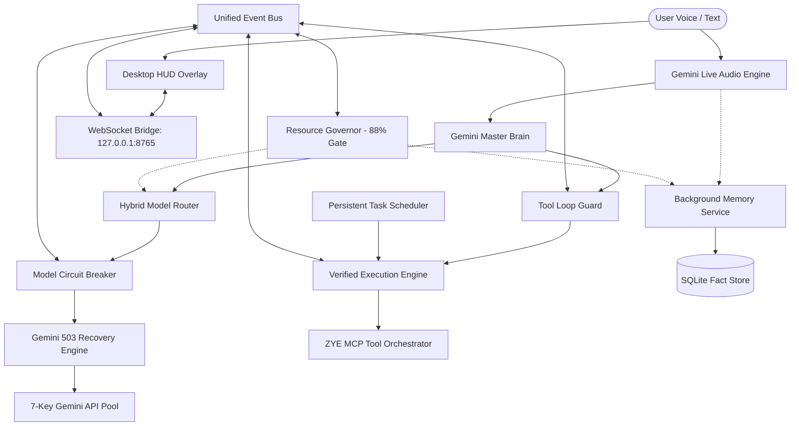

# ZYE AI — Architecture Before & After OpenJarvis Upgrade

**Project:** ZYE AI Hybrid Personal Windows AI Assistant  
**Upgrade Type:** Major Architecture Enhancement via OpenJarvis Engineering Patterns  
**Date:** 2026-11-24  
**Status:** COMPLETE & CERTIFIED  

---

## 1. Executive Summary

ZYE AI has been upgraded with enterprise-grade resilience, multi-model failover, resource-aware intelligence gating, and floating desktop HUD telemetry inspired by OpenJarvis (`OpenJarvis-main.zip`), while preserving ZYE as the sole assistant and Google Gemini as the Master Brain.

---

## 2. Structural Comparison

| Dimension | Before Upgrade | After Upgrade | Impact |
|---|---|---|---|
| **Assistant Identity** | Zye (Standalone Python) | Zye (Preserved 100%, No secondary assistant) | Zero identity fragmentation |
| **Primary Intelligence** | Gemini API (ad-hoc retries) | Gemini Master Brain + `ModelCircuitBreaker` + `GeminiRecoveryEngine` | Immune to 503 retry storms; never burns 7 keys on overload |
| **Model Routing** | Fixed Gemini endpoints | `HybridModelRouter` + `LocalReadinessDetector` | Dynamic routing based on complexity & hardware headroom |
| **Tool Execution Safety** | Single `@zye_safe_skill` gate | `@zye_safe_skill` + `ToolLoopGuard` + `VerifiedExecutionEngine` | Eliminates A-A-A loops, ping-pong cycles, turn budget overruns |
| **Event Architecture** | Ad-hoc callbacks & logs | `ZyeEventBus` (24 event taxonomy types, secret redaction, bounded deque) | Thread-safe pub/sub with complete observer isolation |
| **Resource Management** | Static config thresholds | `ResourceGovernor` (Real-time psutil, hysteresis: 88% trigger, 78% clear) | Hard gate prevents host RAM exhaustion under heavy load |
| **Durable Memory** | Session conversation history | `FactStore` (SQLite WAL) + `MemoryService` (Background daemon worker) | Non-blocking fact extraction; zero latency impact on voice |
| **Task Scheduling** | Ad-hoc asyncio sleeps | `TaskScheduler` (SQLite persistence + Atomic worker leases + Zombie recovery) | Guaranteed single-worker execution with failover |
| **Security & Guardrails** | Basic path containment | `CapabilityPolicy` (RBAC) + `InjectionScanner` (Prompt injection / jailbreak) | Fail-closed capability gating and adversarial detection |
| **Desktop Experience** | Headless / Terminal UI | Floating Glassmorphism HUD (`desktop/overlay.html` + `ws://127.0.0.1:8765`) | Real-time audio waveform, resource gauges, and live event feed |

---

## 3. High-Level Architecture Diagram

---

## 4. Preservation Verification

The following Day 01-41 systems were verified 100% intact and uncompromised:
- `main.py` entrypoint and command dispatcher.
- `zye_gemini_live.py` native voice WebSocket audio pipeline.
- 7-Key Gemini API Manager with credential isolation.
- Negative Pre-Mortem Brain and schema sanitizers.
- Local Music Engine and speech-aware audio ducking.
- Windows application automation and COM interop.
